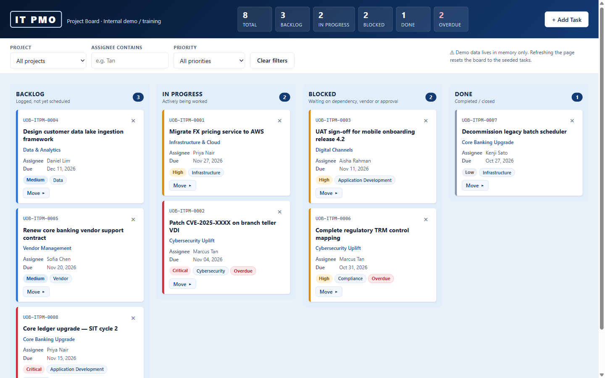

# IT PMO Kanban Board

A single-file Kanban board for IT project management. It is a **demo/training tool for a fictitious bank** and uses no real branding, only a neutral "IT PMO" text wordmark.



<!-- Live demo: add the GitHub Pages URL here once Pages is enabled -->

## Features

- Four columns: Backlog, In Progress, Blocked, Done, each with a live count badge
- Header summary: total, per-status and overdue counts
- Drag and drop cards between columns, or use the keyboard-accessible "Move" menu
- Add Task drawer with inline validation
- Filter by project, assignee and priority
- Priority colour coding and automatic "Overdue" flags
- Inline "Delete? Yes / No" confirmation (no native `alert()` or `confirm()`)
- Optional email notification for new tasks through FormSubmit

## Run it

Double-click `index.html`. There is no server, build step or install.

## Tech notes

- Vanilla HTML, CSS and JavaScript in one file: no frameworks, CDNs, web fonts or image files
- **No persistence.** Data lives in memory, and a refresh re-seeds the demo board
- The only network call is FormSubmit's AJAX endpoint, and it is made only when an address is configured

## Notification setup (optional)

In `index.html`, replace `YOUR_EMAIL@example.com` in `FORMSUBMIT_ENDPOINT`. FormSubmit emails a one-time activation link on the first submission.

> **Warning:** do not commit a real email address to a public repository. It would be exposed in the page source.

## Project structure

```
index.html      The whole app (HTML, CSS, JS)
CLAUDE.md       Guidance for Claude Code
docs/           README screenshot
```

## Licence

Not yet chosen.
